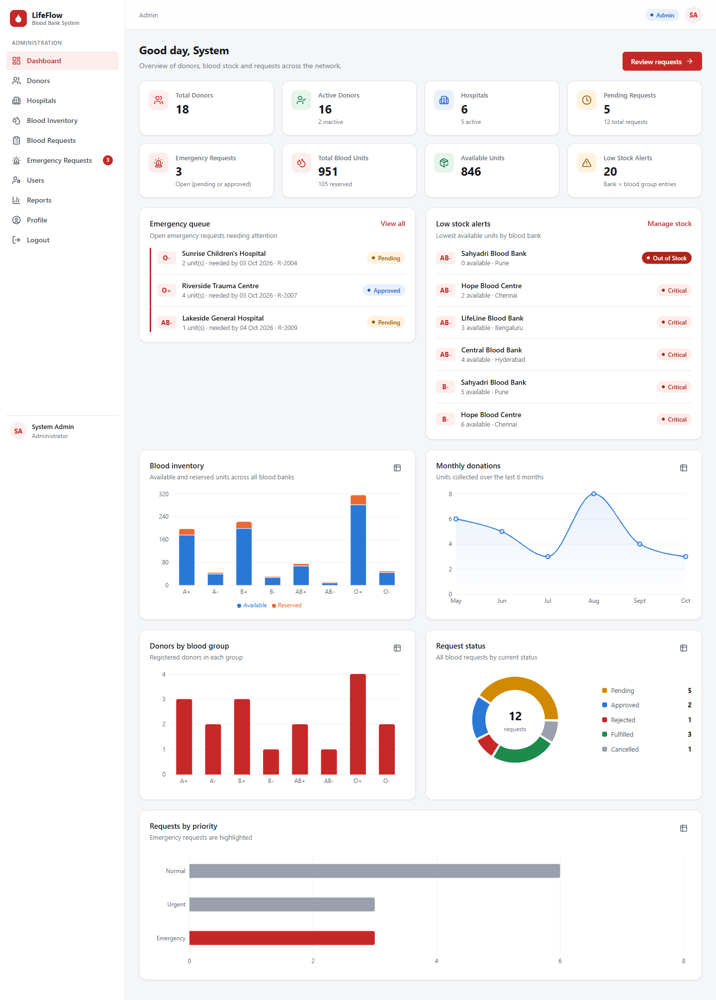
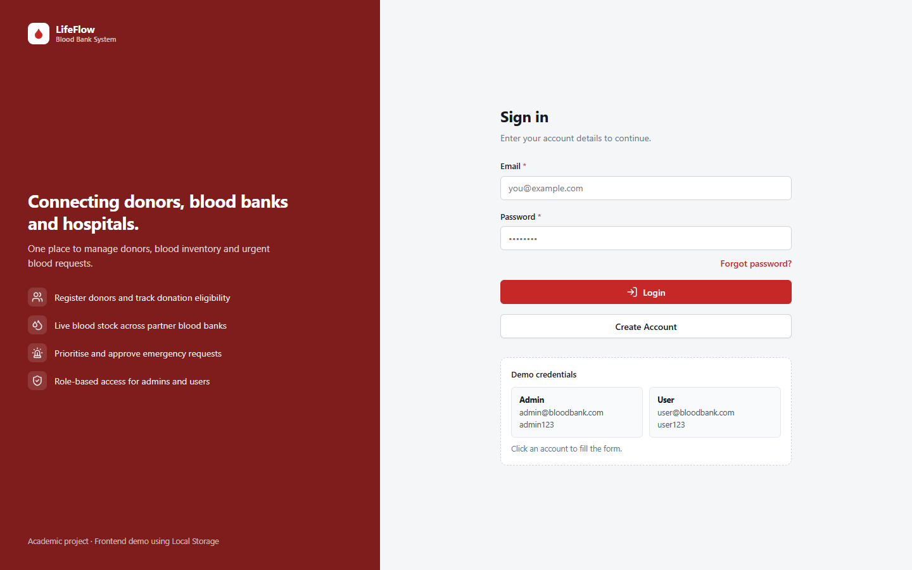
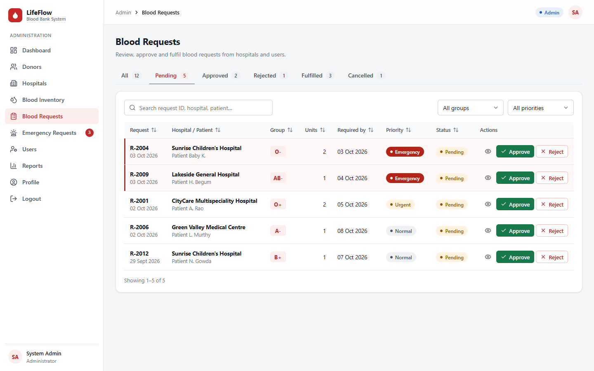
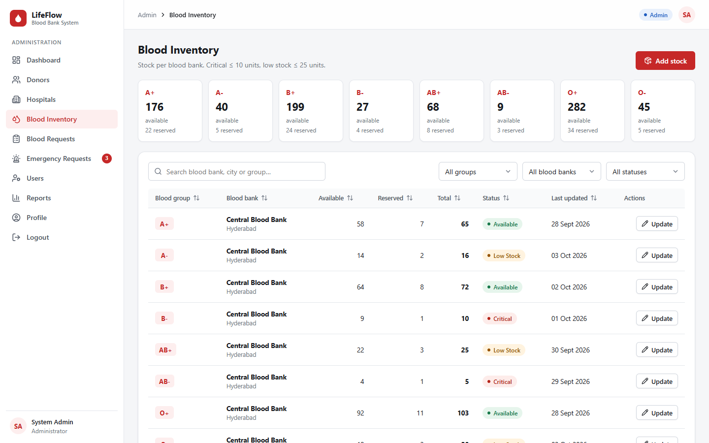
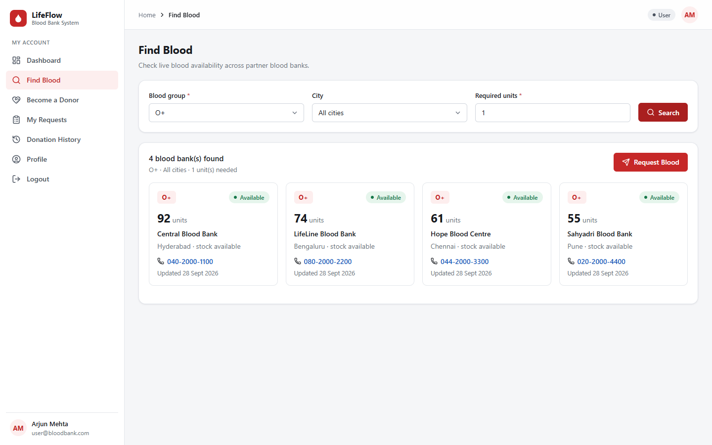
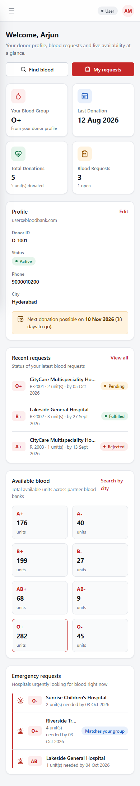

# LifeFlow — Blood Banking System

A responsive web application that connects **blood donors, blood banks and hospitals**. It covers donor registration, blood inventory across several blood banks, blood requests with an approval workflow, and emergency requests.

It is a frontend-only academic project (Project Review 1). All data, including login, is stored in the browser's **Local Storage**.

> **Live demo:** `<add your deployment URL here>`
> **Repository:** `https://github.com/<your-username>/bloodbank`



---

## Demo credentials

| Role  | Email                   | Password   |
|-------|-------------------------|------------|
| Admin | `admin@bloodbank.com`   | `admin123` |
| User  | `user@bloodbank.com`    | `user123`  |
| User (hospital staff) | `hospital@bloodbank.com` | `hospital123` |

The login page also has one-click buttons that fill in these credentials. An admin can restore the original demo data from **Profile → Reset demo data**.

---

## Features

**Authentication (Local Storage)**
- Login, signup (with duplicate-email and password checks), a forgot-password screen (UI only) and logout
- Public signup always creates a `user` account; admin accounts cannot be created through signup
- Role-based navigation and protected routes: users cannot open `/admin/*` pages
- The session survives a page refresh

**Admin**
- Dashboard with 8 statistic cards, an emergency queue, low-stock alerts and 5 charts
- Donor management: search, filter, view details and history, add, edit, activate/deactivate, delete, record a donation
- Hospital management: search, filter, view, add, edit, activate/deactivate, delete
- Blood inventory per blood bank and blood group, with Available / Low Stock / Critical / Out of Stock status, plus add stock and update stock
- Blood requests: status tabs, filters, approve (choose a blood bank and reserve units), reject (with a reason) and fulfil
- Emergency requests view, with an open-emergency counter in the sidebar
- User management: enable/disable and delete accounts
- Reports with summary cards, charts and tables, printable

**User**
- Personal dashboard: blood group, last donation, total donations, request status, available blood and emergency requests
- Become a donor: a validated registration form, with a donation-eligibility check (90-day gap)
- Find blood: search by blood group, city and units, then **Request Blood** with the form prefilled
- My requests: submit, track, view the status timeline, cancel
- Donation history and profile, including password change

**UI/UX**
- Layout built with CSS Grid and Flexbox: sidebar and main content on desktop, an off-canvas drawer on tablet and mobile
- Reusable components: data table (sorting and pagination), modal, toast notifications, badges, empty states, loading states
- Two-column forms on desktop and one column on mobile, with inline validation messages
- Tables scroll horizontally on small screens
- Accessibility: visible focus states, labelled controls, status shown as text as well as colour, and a data-table view for every chart

---

## Business workflow

```
User registers as donor ──► saved to Local Storage ──► appears in Admin › Donors
Admin records donation ───► donation history + inventory +1 unit
User submits request ─────► Admin sees it as Pending (emergencies listed first)
Admin approves ───────────► units move from Available to Reserved at the chosen blood bank
Admin fulfils ────────────► reserved units are issued; user sees "Fulfilled"
User/Admin cancels ───────► any reserved units are released back to Available
```

## Modules

| Module | Main screens |
|---|---|
| Authentication | Login, Signup, Forgot Password, Logout |
| Dashboard | Admin Dashboard, User Dashboard |
| Donor Management | Donors (admin), Become a Donor, Donation History |
| Hospital Management | Hospitals |
| Blood Inventory | Blood Inventory |
| Blood Requests | Blood Requests, Emergency Requests, My Requests |
| Blood Search | Find Blood |
| Reports | Reports |
| Administration | Users, Profile |

## Technologies

- **React 19** (components, props, state, hooks) and **React Router 7**
- **Vite**: development server and production build
- **Recharts** for charts and **lucide-react** for icons
- **Plain CSS** with custom properties, **CSS Grid** and **Flexbox** (no CSS framework)
- **Local Storage** for persistence
- **Git / GitHub**, plus static hosting on Vercel or Netlify

---

## Getting started

Requires Node.js 18 or later.

```bash
git clone https://github.com/<your-username>/bloodbank.git
cd bloodbank
npm install
npm run dev        # http://localhost:5173
npm run build      # production build in dist/
npm run preview    # serve the production build
```

Demo data is seeded the first time the app opens. To reset it, use **Profile → Reset demo data** as admin, or clear the site's Local Storage.

## Deployment

The app is a static single-page application. Both configurations below send every route to `index.html`, so refreshing a page such as `/admin/donors` works.

- **Vercel:** import the repository. The framework preset is Vite, and `vercel.json` handles the rewrites.
- **Netlify:** import the repository. `netlify.toml` sets the build, and `public/_redirects` handles the rewrites.

## Local Storage keys

| Key | Contents |
|---|---|
| `users` | Accounts (`id, name, email, password, phone, role, accountType, status…`) |
| `donors` | Donor records |
| `hospitals` | Partner hospitals |
| `bloodInventory` | One entry per blood bank × blood group (available and reserved units) |
| `bloodRequests` | Blood requests and their status |
| `donationHistory` | Recorded donations |
| `currentUser` | Signed-in user, stored without the password |

## Project structure

```
src/
├── components/   AppLayout, Sidebar, Navbar, Header, StatCard, DataTable, Modal,
│                 FormInput, Select, Badge, EmptyState, Charts, DonorForm, RequestForm…
├── context/      AuthContext (login/signup/session), ToastContext (notifications)
├── hooks/        useStore (live Local Storage subscription), useForm, useMyDonor
├── pages/        Login, Signup, ForgotPassword, AdminDashboard, UserDashboard, Donors,
│                 Hospitals, BloodInventory, BloodRequests, BloodSearch, DonorRegistration,
│                 MyRequests, DonationHistory, Users, Reports, Profile, NotFound
├── routes/       AppRoutes (lazy-loaded routes, ProtectedRoute, PublicRoute)
├── styles/       global.css (design tokens, layout, components, responsive rules)
├── utils/        localStorage.js, seedData.js, validation.js, bloodService.js,
│                 stats.js, format.js, constants.js, navigation.js
├── App.jsx
└── main.jsx
docs/             Presentation guide, LinkedIn article, screenshots
```

## Screenshots

| Login | Blood requests |
|---|---|
|  |  |
| **Blood inventory** | **Find blood** |
|  |  |



## Security note

Local Storage is used **only because this is a frontend academic project**. Passwords are stored in plain text and any user can edit their own browser storage. A production system needs a secure backend: hashed passwords, token- or session-based authentication, server-side authorization, HTTPS, an encrypted database and audit logs.

## Future enhancements

- Backend API (for example Node.js/Express or Spring Boot) with a real database and secure authentication
- SMS or email alerts that notify matching donors about emergency requests
- Blood unit expiry tracking (batch numbers, first-expiry-first-out issuing)
- Map-based search for the nearest blood bank
- Donation camp scheduling and donor appointment booking
- Multi-language support and a dark theme

## Data disclaimer

All names, phone numbers, emails, hospitals and blood banks in the demo data are fictional.
